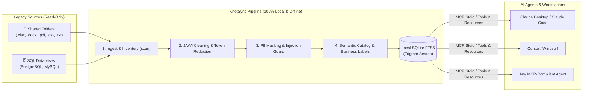

# KnotSync

> **The Open-Source Semantic Layer for Legacy Enterprise Data.**  
> Scan, clean, and serve legacy office documents and databases to AI agents via the [Model Context Protocol (MCP)](https://modelcontextprotocol.io).

[](https://www.npmjs.com/package/@hoanghainh/knot-sync)
[](https://github.com/hoanghainh1188/knot-sync/actions)
[](https://opensource.org/licenses/Apache-2.0)
[](https://nodejs.org)
[](https://modelcontextprotocol.io)

[English](./README.md) • [日本語](./docs/ja/README.md) • [Tiếng Việt](./docs/vi/README.md)

---

## Why KnotSync?

Legacy enterprise data is a goldmine for internal AI agents, but feeding it directly to LLMs often fails:

- **Legacy Japanese & Vietnamese Data**: Documents are riddled with old font encodings (TCVN3, VNI), Japanese era names (和暦 - Meiji/Taisho/Showa/Heisei/Reiwa), full-width digits, and non-standard dates that distort LLM reasoning.
- **Cryptic Databases**: Legacy schemas use abbreviated column names (`TKSK_CD`, `ma_kh`) that lead agents to hallucinate incorrect queries.
- **Security & Privacy Risks**: Sensitive PII (CCCD, My Number, credit cards) and prompt injection traps (hidden white-on-white text, zero-width instructions) slip unnoticed into AI prompts.
- **Token Inefficiency**: Messy spreadsheets with repeated blank rows and unnormalized tables waste 30–50% of your LLM context budget.

**KnotSync acts as a local semantic shield and data adapter**: It ingests your legacy files and databases, normalizes text, strips PII, blocks prompt injections, enriches schemas with human business labels, and serves clean context via MCP — **100% on-premises, completely read-only, and zero internet required**.

---

## Architecture & Data Flow



---

## Key Features

- 🛡️ **100% On-Premise & Zero-Trust**: Everything runs on your local machine using Node.js built-ins. Zero telemetry, no cloud dependencies, and zero internet calls. Sources are strictly **read-only**.
- 🇯🇵 🇻🇳 **Deep Japanese & Vietnamese Legacy Support**:
  - Automatically converts Japanese imperial eras (和暦: 明治, 大正, 昭和, 平成, 令和 including 元年) to Gregorian dates.
  - Detects and converts legacy Vietnamese encodings (TCVN3, VNI-Windows) to clean UTF-8.
  - Normalizes full-width alphanumeric characters (NFKC) and unifies heterogeneous date formats to ISO 8601.
  - Collapses empty spreadsheet rows/columns, reducing token usage by 30–50%.
- 🏷️ **Semantic Catalog (Explain Cryptic Fields)**:
  - Introspects SQL tables and maps cryptic column names (`TKSK_CD` → "得意先コード" / "customer code", `ma_kh` → "mã khách hàng").
  - Ingests company-specific dictionary files or legacy Excel table definitions (テーブル定義書 / 項目定義書).
  - Includes a local web UI (`knot-sync ui`) to review, label, and approve mappings.
- 🔒 **PII Masking & Safety Guard**:
  - Mask, hash, or drop PII: Japanese My Number (with checksum), Vietnamese CCCD (12 digits), phone numbers (JP/VN), emails, and credit cards (Luhn).
  - Blocks indirect prompt injections: detects instruction overrides in English, Japanese, and Vietnamese, zero-width / bidi control characters, and extractor-exposed hidden text.
- ⚡ **First-Class MCP Server (`serve`)**:
  - Exposes documents and SQL tables as native MCP Resources (`knot://...`) and Tools (`search_documents`, `get_document`, `describe_table`, `query_table`).
  - Strict input validation via Zod; all document content is wrapped in an `UNTRUSTED DATA` frame to prevent jailbreaks.
  - Appends every tool invocation to an append-only JSONL audit log.
- 🔌 **Extensible Plugin System**:
  - Add custom connectors, extractors, cleaners, PII rules, and MCP tools. Plugins run in-process with full trust.

---

## Comparison: KnotSync vs Alternatives

| Feature | Raw File Ingestion / Basic RAG | Cloud Parsers (Unstructured, LlamaParse) | **KnotSync** |
|---|:---:|:---:|:---:|
| **Deployment** | Local scripts | ❌ Cloud API (Sends data over Internet) | ✅ **100% Local & Air-gapped** |
| **Source Safety** | Manual precaution | Read-only | ✅ **Enforced Read-Only (Session level)** |
| **Japanese Wareki (和暦)** | ❌ Distorts years | ❌ Limited / Raw text only | ✅ **Native conversion to Gregorian** |
| **Vietnamese TCVN3 / VNI** | ❌ Unreadable garbled text | ❌ Unsupported | ✅ **Auto-detect & convert to Unicode** |
| **Cryptic DB Cataloging** | ❌ Hallucinates column names | ❌ Documents only (No SQL) | ✅ **Semantic Catalog (YAML/Excel/UI)** |
| **Indirect Prompt Guard** | ❌ None | ❌ None | ✅ **Built-in multi-lingual injection guard** |
| **AI Protocol** | Custom APIs | REST API | ✅ **Native Model Context Protocol (MCP)** |
| **External Dependencies** | High | Heavy Docker/Python stack | ✅ **Zero native binaries (Fast Node.js)** |

---

## Quickstart (5-Minute Tour)

**Prerequisite**: Node.js **22.13** or newer.

KnotSync is distributed as a single npm package: `@hoanghainh/knot-sync`.

```bash
# 1. Initialize configuration for your local shared folder
npx @hoanghainh/knot-sync init --path /path/to/shared/folder

# 2. Scan sources: inspect file inventory, duplicates, and health
npx @hoanghainh/knot-sync scan

# 3. Ingest, extract, clean (JA/VI), mask PII, and build local search index
npx @hoanghainh/knot-sync run

# 4. (Optional) For SQL sources: build the Semantic Catalog
npx @hoanghainh/knot-sync describe

# 5. Start the MCP server over stdio for AI agents
npx @hoanghainh/knot-sync serve
```

---

## Step-by-Step Commands

### 1. `scan`: Audit Data Health
Scans configured folders and SQL tables without extracting text:
```bash
npx @hoanghainh/knot-sync scan
npx @hoanghainh/knot-sync scan --json
npx @hoanghainh/knot-sync scan --pii              # Estimate files containing PII
npx @hoanghainh/knot-sync scan --report           # Generate offline HTML Health Report
```
Example terminal output:
```text
■ Source "finance": 142 files, 84.2 MB

  By type:
    xlsx   84   62.1 MB
    pdf    36   18.4 MB
    docx   22    3.7 MB

  Health:
    Duplicate copies     18   12.4 MB wasted
    Older than 5 years   29
    Empty files           3
    Unreadable            0

  Biggest duplicates:
    4.1 MB × 3
      - 営業/2023_見積書 (1).xlsx
      - 営業/2023_見積書.xlsx
      - 営業/2023_見積書_最新_fix.xlsx
```

### 2. `run`: Ingest & Normalize Pipeline
Extracts text and tables from `.xlsx`, `.docx`, `.pdf` (text-based), `.csv`, `.tsv`, `.txt`, `.md` into a local SQLite store (`node:sqlite`).
- **Cleaning**: NFKC normalization, Wareki $\rightarrow$ Gregorian, ISO 8601 dates, TCVN3/VNI conversion, and whitespace/empty-row token reduction.
- **PII Masking**: Mask (`***`), hash, or drop sensitive numbers.
- **Guardrails**: Flags prompt-injection patterns, zero-width chars, and hidden cells.
- **Incremental**: Unchanged files (matching SHA-256 hash) are skipped automatically.

### 3. `ui`: Review Semantic Catalog
Launches a bundled React review interface on **127.0.0.1:8787** (loopback only) to edit business names, descriptions, and mark columns as reviewed:
```bash
npx @hoanghainh/knot-sync ui --lang ja
# Open http://127.0.0.1:8787/?lang=ja
```

### 4. `bench`: Measure Token Reduction & Accuracy
Measures before/after token reduction and runs benchmark suites (`knot-sync.bench.yaml`) to verify search accuracy and catalog resolution offline:
```bash
npx @hoanghainh/knot-sync bench
npx @hoanghainh/knot-sync bench --suite ./examples/sample.bench.yaml
```

---

## MCP Agent Integration (`serve`)

`knot-sync serve` communicates over **stdio** (no open network ports). It enforces read-only access and wraps all outputs in an untrusted data frame.

### MCP Surfaces Exposed

| Surface | Identifier | Description |
|---|---|---|
| **Resource** | `knot://sources` | List all configured data sources |
| **Resource** | `knot://docs/{source}/{doc_id}` | Retrieve a clean document with metadata |
| **Resource** | `knot://db/{source}/{table}/schema` | Retrieve allow-listed SQL schema & business labels |
| **Tool** | `search_documents` | Trigram full-text search (`query`, `source`, `type`, `limit`) |
| **Tool** | `get_document` | Fetch document by its unique ID |
| **Tool** | `describe_table` | Inspect allowed columns, data types, and business descriptions |
| **Tool** | `query_table` | Parameterized SQL query with safe filters (`eq`, `in`, `range`, `contains`) |

### Registering in Claude Desktop

Add KnotSync to your `claude_desktop_config.json`:

```json
{
  "mcpServers": {
    "knot-sync": {
      "command": "npx",
      "args": ["@hoanghainh/knot-sync", "serve", "-c", "/absolute/path/to/knot-sync.config.yaml"]
    }
  }
}
```

### Registering in Cursor / Windsurf

Add to `.cursor/mcp.json`:

```json
{
  "mcpServers": {
    "knot-sync": {
      "command": "npx",
      "args": ["@hoanghainh/knot-sync", "serve", "-c", "/absolute/path/to/knot-sync.config.yaml"]
    }
  }
}
```

---

## SQL Sources (PostgreSQL & MySQL)

KnotSync connects to SQL databases in **strict read-only transaction mode**. Database credentials must be provided via environment variables (`url: env:VAR_NAME`) — never stored in plain text. Only tables and columns explicitly declared in `allow:` are exposed.

```yaml
# knot-sync.config.yaml
sources:
  - id: erp_database
    type: postgres
    url: env:KNOT_PG_URL
    allow:
      受注:
        columns: [受注番号, TKSK_CD, 金額]
      hoa_don:
        columns: [so_hd, ma_kh, so_tien]
```

Run `knot-sync describe` to generate `knot-sync.catalog.yaml` and enrich cryptic columns with business names:

```yaml
# knot-sync.catalog.yaml
version: 1
sources:
  erp_database:
    tables:
      受注:
        columns:
          TKSK_CD:
            label: { ja: "得意先コード", vi: "mã khách hàng", en: "customer code" }
            reviewed: true
```

---

## Multilingual Support (`--lang`)

CLI output, error messages, and progress indicators are fully localized in **English**, **Japanese (日本語)**, and **Vietnamese (Tiếng Việt)**:

```bash
npx @hoanghainh/knot-sync --help --lang ja
npx @hoanghainh/knot-sync scan --lang vi
```

Resolution precedence: `--lang` flag $\rightarrow$ config `cli.locale` $\rightarrow$ `KNOT_SYNC_LANG` / `LANG` environment variable $\rightarrow$ fallback to `en`.

---

## Monorepo Architecture

KnotSync is structured as a clean, modular TypeScript monorepo managed by `pnpm`. Only `@hoanghainh/knot-sync` (bundled CLI) is published to npm.

| Package | Responsibility |
|---|---|
| [`packages/core`](./packages/core) | Data models (`Document`, `FileEntry`), config loader, plugin host API |
| [`packages/connector-fs`](./packages/connector-fs) | Read-only folder walker and file inventory scanner |
| [`packages/connector-sql`](./packages/connector-sql) | Read-only PostgreSQL and MySQL connector, schema introspection |
| [`packages/extractor-office`](./packages/extractor-office) | Document text & table extractor (`.xlsx`, `.docx`, `.pdf`, `.csv`, `.md`, `.txt`) |
| [`packages/cleaner-ja-vi`](./packages/cleaner-ja-vi) | Text normalizer: NFKC, Wareki, ISO dates, TCVN3/VNI, token reduction |
| [`packages/pii-basic`](./packages/pii-basic) | Rule-based PII mask/hash/drop (CCCD, My Number, phones, emails, credit cards) |
| [`packages/guard`](./packages/guard) | Multi-lingual indirect prompt injection detector |
| [`packages/store-sqlite`](./packages/store-sqlite) | `node:sqlite` store with FTS5 trigram search |
| [`packages/catalog`](./packages/catalog) | Semantic Catalog YAML manager, dictionary resolver, Excel definition parser |
| [`packages/ui`](./packages/ui) | Bundled React catalog review UI (runs on loopback `127.0.0.1`) |
| [`packages/mcp-server`](./packages/mcp-server) | Official Model Context Protocol stdio server |
| [`packages/report-html`](./packages/report-html) | Self-contained, zero-dependency offline HTML scan report |
| [`packages/cli`](./packages/cli) | Unified CLI entrypoint (`knot-sync`) |

### Development & Contributing

```bash
# Enable pnpm via corepack
corepack enable
pnpm install

# Build all packages and UI client
pnpm build

# Run unit and integration tests (100% pass)
pnpm test

# Test scan against sample data
pnpm scan:sample
```

- **Zero native dependencies**: Uses Node.js 22 built-in `node:sqlite`, ensuring blazing-fast installation with zero build toolchain requirements.
- **Strictly vetted dependencies**: External libraries are kept to an absolute minimum (`yaml`, `@modelcontextprotocol/sdk`, `zod`, `exceljs`, `mammoth`, `unpdf`, `pg`, `mysql2`).

---

## Roadmap

Development follows the [OpenSpec](https://github.com/Fission-AI/OpenSpec) specification process. See [docs/ROADMAP.md](./docs/ROADMAP.md) for the active roadmap and upcoming milestones:

- [x] **v0.1**: Core pipeline, Office extractors, JA/VI cleaners, PII masking, Injection guard, MCP Server, SQL connectors, Semantic Catalog.
- [x] **v0.2**: CLI i18n (EN/JA/VI), Catalog Review UI, Token/accuracy Benchmarking suite.
- [ ] **v0.3**: Production Hardening (OOM/timeout protection, custom SQL schemas, HTTP/SSE MCP transport, expanded regional PII).

---

## License

[Apache-2.0](./LICENSE) © 2026 Hoàng Hải Anh.
