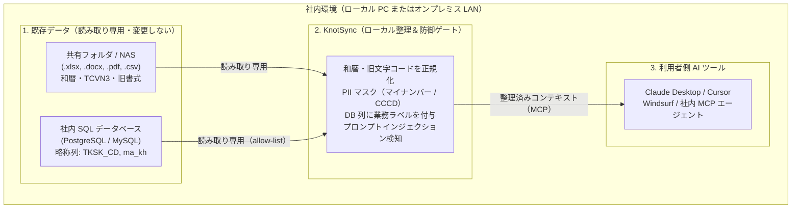
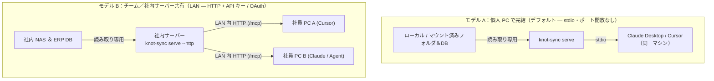

# KnotSync（日本語概要）

> **社内のレガシーデータと AI エージェントの間に入る、ローカル専用の整理・マスキング・MCP ゲートウェイ。**  
> 古い Office 文書（`.xlsx`, `.docx`, `.pdf`）や略称だらけの社内データベースを、**元データを一切変更せず、クラウドへ送信せず**に [Model Context Protocol (MCP)](https://modelcontextprotocol.io) 経由で AI に安全に渡します。

---

## KnotSync は何をするツール？

KnotSync は、社内の古いファイルサーバーやデータベースと、Claude Desktop / Cursor などの AI ツールの間に立つ**「ローカル専属のクリーニング＆通訳ゲート」**です。

日系・ベトナム系企業に蓄積されたデータをそのまま AI に渡すと、次の問題が起きがちです。
- **和暦・旧フォント・全角混在**: 明治〜令和の和暦、ベトナム語の旧フォント（TCVN3 / VNI）、全角数字や余白だらけの Excel が AI の解釈を歪めます。
- **略称だらけの DB 列名**: `TKSK_CD` や `ma_kh` のような物理名だけでは AI が誤った SQL を生成します。
- **個人情報（PII）とプロンプトインジェクション**: マイナンバー・CCCD・クレジットカード番号や文書内の隠し命令がそのままプロンプトに入ります。
- **トークン浪費**: 無駄な空行や重複ヘッダーでコンテキストが膨らみます（削減量は手元の `knot-sync bench` で実測してください。一律の％主張は掲載しません）。

### 立場別のメリット

| 立場 | 気になるところ | KnotSync が提供すること |
|---|---|---|
| **PM / 業務責任者** | 既存業務やファイルを壊さず、AI に社内文書や業務用語を正しく理解させたい | 元ファイルは変更せず、和暦・TCVN3 や業務ラベル（`TKSK_CD`＝得意先コード）を AI が正しく扱えるようにします |
| **情シス / セキュリティ担当** | 社内データを外部に出したくない・個人情報を守りたい | ソースは**読み取り専用**、**ローカル優先**（無料コアは実行時の外向き通信・テレメトリなし）、PII マスク、監査ログをローカル保存 |
| **開発者 / 導入担当** | 自前パーサーを書かずに Claude / Cursor へすぐ繋ぎたい | 1 つの CLI（`@hoanghainh/knot-sync`）で全文検索と `allow:` 制限付き SQL を標準 **MCP**（`stdio` / `--http`）で公開 |

### KnotSync が「やること」と「やらないこと」

- ✅ **やること**: ローカルでのテキスト正規化、PII マスキング、DB 列名の意味付け（Semantic Catalog）、読み取り専用 MCP 配信。
- ❌ **やらないこと**: AI チャット画面そのものの提供（Claude Desktop / Cursor / 自社エージェントから接続して使います）。
- ❌ **やらないこと**: 元ファイル・元データベースへの書き込みや移動（完全読み取り専用）。
- ❌ **やらないこと**: 外部クラウドへのデータ送信（有料プラグインを有効にした場合も、接続先は手元・LAN 内の Ollama / Docker / OCR のみ）。

---

## 導入イメージ：社内システムでの立ち位置

### 1. 社内ネットワーク上の全体像



### 2. 2 つの実運用モデル



---

## 具体例：Before / After と AI での使われ方

### 1. AI に渡す前にどう変わるか

| 項目 | 元データ（Before） | AI に渡るデータ（After） |
|---|---|---|
| **和暦の日付** | `契約開始日: 令和6年4月1日` | `契約開始日: 2024-04-01`（ISO 8601） |
| **ベトナム語旧フォント** | `B¸o c¸o doanh thu - NguyÔn V¨n A` (TCVN3) | `Báo cáo doanh thu - Nguyễn Văn A` (UTF-8) |
| **個人情報（PII）** | `マイナンバー: 123456789016` / `CCCD: 079123456789` | `マイナンバー: ***` / `CCCD: ***` |
| **略称 DB 列名** | `SELECT TKSK_CD, 金額 FROM 受注` | カタログ経由で `TKSK_CD`＝*「得意先コード / customer code」* と理解 |
| **隠し命令（Injection）** | 白文字の指示文 `"Ignore rules..."` | 検知して `UNTRUSTED DATA` 枠内に隔離 |

### 2. Claude Desktop / Cursor でのやり取り例

> **社員の質問:** *「2024年4月以降の ABC 社との契約書を探して、ERP 上の受注金額合計も確認して」*
>
> 1. AI が `search_documents(query="ABC")` を呼び出し、`令和6年4月1日` → `2024-04-01` に変換済み・PII マスク済みの契約書を取得。
> 2. AI が `describe_table(...)` で `TKSK_CD`＝得意先コード、`金額`＝受注金額であることを確認。
> 3. AI が `query_table(...)` で `allow:` 許可列のみをパラメータ化クエリで読み取り、根拠付きで回答。

---

## 前提

- Node.js **22.13** 以上
- **ローカル優先**で動作します（テレメトリなし。無料コアは実行時に外向き通信しません）
- 有料プラグインを有効にすると、手元の Ollama / Docker / OCR など**ローカル推論**へ接続できます
- データソースは**読み取り専用**です。ファイルやデータベースの内容を変更しません
- 効果指標（トークン削減・検索精度など）は公開の平均値ではなく、手元の `knot-sync bench` で測ってください
- 現状: open-core v0.1–v0.3 と Paid #1–#7 は完了。次は After v1.0（書き込みツール、人の承認付き）。詳細は [docs/ROADMAP.md](../ROADMAP.md)

---

## クイックスタート（データに合わせて選択）

10 個のコマンドをすべて使う必要はありません。対象データに合う流れを選んでください。

### パターン A：共有フォルダの文書（Excel / Word / PDF）だけ使う場合（4 ステップ）

```bash
# 1. 設定ファイルを作成
npx @hoanghainh/knot-sync init --path /path/to/shared/folder

# 2. ソースの棚卸し（ファイル数・重複・古いファイル。--report で HTML 出力）
npx @hoanghainh/knot-sync scan

# 3. 抽出・和暦/VI 正規化・PII マスクを実行してローカル SQLite に保存
npx @hoanghainh/knot-sync run

# 4. MCP サーバー（stdio）を起動して Claude Desktop / Cursor から接続
npx @hoanghainh/knot-sync serve
```

### パターン B：社内 SQL データベース（PostgreSQL / MySQL）も繋ぐ場合

`knot-sync.config.yaml` に `postgres` / `mysql` ソースと `allow:` 許可テーブルを追記したうえで実行します：

```bash
# 1. allow 対象テーブルから Semantic Catalog（knot-sync.catalog.yaml）を生成
npx @hoanghainh/knot-sync describe

# 2. ローカル UI（127.0.0.1:8787）で列の日本語/ベトナム語ラベルを確認・承認
#（※AI チャット画面ではなく、DB 列名の意味を人間が確認する画面です）
npx @hoanghainh/knot-sync ui

# 3. MCP サーバーを起動（チーム共有時は --http）
npx @hoanghainh/knot-sync serve
# 任意（LAN 共有）: export KNOT_SYNC_API_KEY=... && npx @hoanghainh/knot-sync serve --http
```

### 2 分で試せるローカルデモ（このリポジトリから）

社内データへ繋ぐ前に、和暦変換・TCVN3 変換・PII マスク・カタログレビュー UI の動きを手元で確認できます:

```bash
pnpm install
pnpm build
pnpm demo:prepare
node packages/cli/dist/bin.js scan -c examples/demo.config.yaml
node packages/cli/dist/bin.js run -c examples/demo.config.yaml
node packages/cli/dist/bin.js ui -c examples/demo.config.yaml --lang ja
```

公開後のバージョン確認例:

```bash
npx @hoanghainh/knot-sync@0.2.0 --version
```

---

## コマンド一覧（作業段階別）

| 段階 | コマンド | 役割 |
|---|---|---|
| **1. 準備・棚卸し** | `init` | 設定ファイルを作成 |
| | `scan` | ソースの棚卸し（種類・重複・古いファイル・`--report` HTML） |
| **2. データ整備** | `run` | テキスト／表を抽出・正規化・PII マスクしてローカルストアへ保存 |
| | `describe` | *（SQL 利用時）* Semantic Catalog（`knot-sync.catalog.yaml`）を生成・更新 |
| | `ui` | *（SQL 利用時）* ローカル UI でカタログを確認・`reviewed` を保存（`127.0.0.1`） |
| **3. AI へ配信** | `serve` | MCP サーバーを起動（stdio、または `--http` + API キー） |
| **任意・運用** | `bench` | クリーニング前後のトークン見積もりとスイート（検索／カタログ）を計測 |
| | `optimize` | ストアの FTS5 optimize と WAL チェックポイントを実行 |
| | `embed` | ベクトル埋め込み一括作成（`search-vector` プラグインが必要） |
| | `plugins` | 読み込み済みプラグインを表示 |

`bench` は `scan` / `run` 後のストアを読みます。任意で設定と同じ場所の `knot-sync.bench.yaml`（または `--suite`）を実行します。ソースへは書き込みません。結果はデータ依存です。マーケティング用の固定％は掲載しません。

有料プラグイン（OCR / 方眼紙 / 企業 SQL / OAuth / catalog-llm / search-vector / guard-llm）は **npm 上の別パッケージとしては公開されません**。モノレポのパッケージパスを設定の `plugins:` に列挙し、各ライセンス環境変数を設定して有効化します（コアはライセンスを検査しません）。英語の詳細は [README.md](../../README.md) の Paid plugins 表を参照。

---

## MCP サーバー接続ガイド（`serve`）

既定では `knot-sync serve` は **stdio**（ネットワークポートを開かない形式）で Claude Desktop / Cursor に接続します。アクセスは常に**読み取り専用**で、返却される文書本文は `UNTRUSTED DATA` 枠で保護され、すべての呼び出し履歴がローカルの `mcp-audit.jsonl`（`server.audit_log`）に記録されます。

### チーム／社内 LAN 向け HTTP モード（任意）

```bash
export KNOT_SYNC_API_KEY='your-shared-secret'
npx @hoanghainh/knot-sync serve --http --port 3000
# http://127.0.0.1:3000/mcp で待ち受け（--host で変更可）
```

クライアントは `Authorization: Bearer <KNOT_SYNC_API_KEY>` を送信します。API キーは**環境変数専用**です（YAML に書かないでください）。トランスポートは `/mcp` の MCP **Streamable HTTP** です。

### AI に公開される MCP Tools / Resources

| 種別 | 識別子 | 説明 |
|---|---|---|
| **Resource** | `knot://sources` | 設定済みデータソース一覧 |
| **Resource** | `knot://docs/{source}/{doc_id}` | クリーニング済み文書とメタデータを取得 |
| **Resource** | `knot://db/{source}/{table}/schema` | 許可された SQL スキーマと業務ラベルを取得 |
| **Tool** | `search_documents` | トライグラム全文検索（`query`, `source`, `type`, `limit`） |
| **Tool** | `get_document` | ID 指定で文書を取得 |
| **Tool** | `describe_table` | 許可列・データ型・業務説明を確認 |
| **Tool** | `query_table` | 安全なフィルタ付きパラメータ化 SQL 検索（`eq`, `in`, `range`, `contains`, `starts_with`, `between_dates`, `is_null`） |
| **Tool** | `search_similar` | ベクトル類似検索（`search-vector` プラグイン有効時のみ） |

### Claude Desktop への登録（`claude_desktop_config.json`）

```json
{
  "mcpServers": {
    "knot-sync": {
      "command": "npx",
      "args": ["@hoanghainh/knot-sync", "serve", "-c", "/absolute/path/to/knot-sync.config.yaml"]
    }
  }
}
```

### Cursor / Windsurf への登録（`.cursor/mcp.json`）

```json
{
  "mcpServers": {
    "knot-sync": {
      "command": "npx",
      "args": ["@hoanghainh/knot-sync", "serve", "-c", "/absolute/path/to/knot-sync.config.yaml"]
    }
  }
}
```

---

### メッセージ言語

ヘルプやエラーを日本語にする例:

```bash
npx @hoanghainh/knot-sync --help --lang ja
```

設定の `cli.locale: ja` でも同様（`--lang` が優先）。コマンド名や `--json` のキーは英語のままです。

詳細（英語）: リポジトリ直下の [README.md](../../README.md) と [docs/ROADMAP.md](../ROADMAP.md)。
